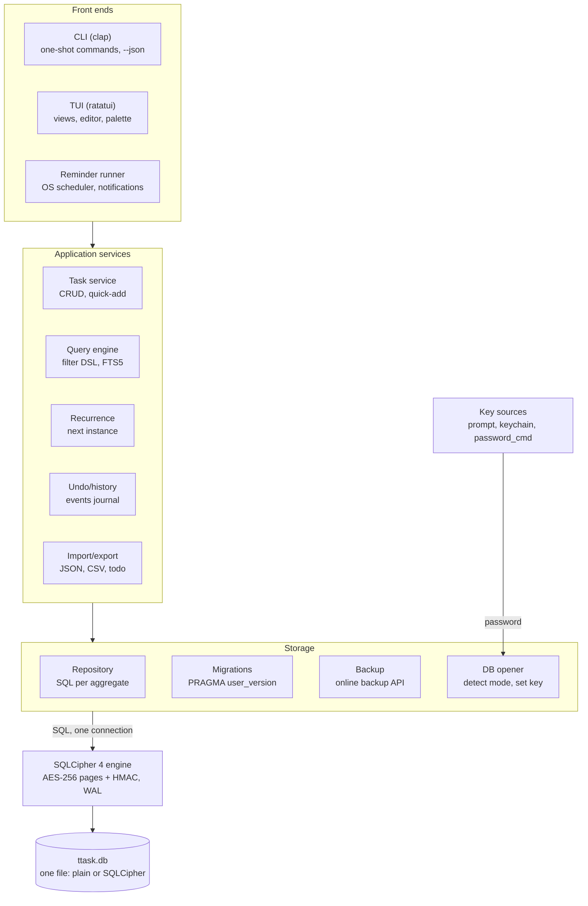
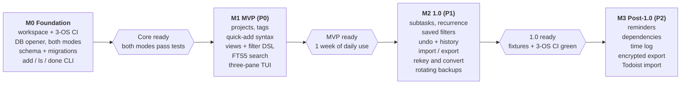

# ttask — Terminal Task Tracker: Design Document

2026-10-15 · Sebastian

> Source of truth: <https://claude.ai/code/artifact/f6233bfd-b98c-4e88-aad4-8992eb6abb6d> (synced at rev 18; diagrams redrawn as Mermaid).

## Overview

ttask is a single-binary, keyboard-driven personal task tracker for the terminal. All data lives in one local SQLite file that is either plain or encrypted with a password; nothing leaves the machine unless the user exports it.

It has two faces over the same core: a scriptable CLI (`ttask add "Pay rent tomorrow #home !high"`) for quick capture and shell pipelines, and a full-screen TUI (`ttask` with no arguments) for triage, planning and review.

**Goals**

- Capture a task in under 3 seconds from any shell.
- Cover the full task lifecycle: projects, tags, priorities, due/scheduled dates, recurrence, subtasks, notes, reminders, search, history.
- Optional at-rest encryption with a password, switchable after creation.
- Run on Windows, macOS and Linux from one codebase, with no server or daemon required.
- Stay fast with 50,000+ tasks: every TUI view renders in under 50 ms.

**Non-goals (v1)**

- Multi-user collaboration or a hosted sync service.
- A GUI or web client.
- Time tracking beyond a simple start/stop log per task.
- Two-way sync with third-party services (Todoist, Jira); one-way import/export only.

**Target user**: a developer or power user who lives in the terminal, wants their task list private and offline, and values keyboard speed over mouse discoverability.

## Requirements

The MVP must ship the P0 rows; P1 rows land before 1.0; P2 rows are post-1.0.

**Functional**

| ID | Requirement | Priority |
| --- | --- | --- |
| F1 | Create, edit, complete, reopen, delete (soft) tasks | P0 |
| F2 | Task fields: title, notes (Markdown), priority, due date/time, scheduled (start) date, estimate | P0 |
| F3 | Projects (nestable one level) and free-form tags | P0 |
| F4 | Natural quick-add syntax: `#project +tag !priority due:fri` | P0 |
| F5 | Built-in views: Inbox, Today, Upcoming, Overdue, Project, Tag, Done/Logbook | P0 |
| F6 | Filter and full-text search across titles and notes | P0 |
| F7 | Plain or password-encrypted database, chosen at init | P0 |
| F8 | Change password; encrypt an existing plain DB; decrypt to plain | P1 |
| F9 | Subtasks (one level) and checklist items | P1 |
| F10 | Recurring tasks (daily/weekly/monthly/yearly, RRULE subset, "after completion" mode) | P1 |
| F11 | Saved filters ("smart lists") | P1 |
| F12 | Import/export: JSON (lossless), CSV, Markdown, todo.txt | P1 |
| F13 | Undo for the last N mutations; per-task change history | P1 |
| F14 | Reminders via desktop notifications | P2 |
| F15 | Dependencies (task B blocked by task A) | P2 |
| F16 | Simple time log (start/stop) per task | P2 |

**Non-functional**

| ID | Requirement | Target |
| --- | --- | --- |
| N1 | Startup to first frame (plain DB) | < 150 ms |
| N2 | Startup incl. key derivation (encrypted DB) | < 1 s |
| N3 | View render / filter latency at 50k tasks | < 50 ms |
| N4 | Durability | No data loss on crash or power cut (SQLite WAL + fsync) |
| N5 | Portability | Windows 10+, macOS 12+, Linux x86_64/arm64; single static-ish binary |
| N6 | Terminal support | Works in Windows Terminal, iTerm2, Alacritty, GNOME Terminal, tmux; 80×24 minimum |
| N7 | Accessibility | Full keyboard control; respects `NO_COLOR`; no meaning conveyed by colour alone |
| N8 | Privacy | No network access in the core; no telemetry |

## Technology choices

Recommendation: **Rust**, with **ratatui** for the TUI and **rusqlite** built with its `bundled-sqlcipher-vendored-openssl` feature. That combination compiles SQLCipher and OpenSSL into one self-contained binary on Windows, macOS and Linux, so encrypted and plain databases use the same engine and no system libraries are needed.

**Stacks considered**

| Stack | Encrypted SQLite story | Distribution | Startup | Verdict |
| --- | --- | --- | --- | --- |
| Rust + ratatui + rusqlite (SQLCipher bundled) | First-class: one Cargo feature, vendored OpenSSL | Single binary, ~6–9 MB | ~10 ms | **Chosen** |
| Go + Bubble Tea + go-sqlcipher | Needs cgo; Windows cross-compiles are painful | Single binary if cgo toolchain works | ~10 ms | Runner-up |
| Python + Textual + sqlcipher3 | Wheels exist but platform coverage is patchy | Needs Python or a 30+ MB frozen bundle | 300–600 ms | Rejected: misses N1 |

**Crates (v1)**

| Concern | Crate | Notes |
| --- | --- | --- |
| TUI rendering | `ratatui` 0.30 + `crossterm` | `ratatui::run()` handles terminal init/restore, incl. on panic |
| Text input widgets | `tui-textarea` | Multi-line notes editor; `$EDITOR` handoff for long notes |
| CLI parsing | `clap` (derive) + `clap_complete` | Shell completions for bash, zsh, fish, PowerShell |
| Database | `rusqlite` 0.40, features `bundled-sqlcipher-vendored-openssl`, `backup`, `serde_json` | Same engine for plain and encrypted files |
| Migrations | Built-in runner (~30 lines) | Versioned via `PRAGMA user_version`; avoids `rusqlite_migration` pinning a second `libsqlite3-sys` |
| Dates and time zones | `jiff` | Time-zone-aware; DST-correct recurrence arithmetic |
| Recurrence | `rrule` | RFC 5545 subset |
| Secrets in memory | `secrecy` + `zeroize` | Password and key wiped on drop |
| Password prompt | `rpassword` | No echo, works in Windows console |
| OS keychain (optional) | `keyring` | Windows Credential Manager, macOS Keychain, Secret Service |
| Paths | `directories` | Platform-correct data/config dirs |
| Import/export | `serde`, `serde_json`, `csv` | |
| Fuzzy matching | `nucleo-matcher` | Command palette and quick jump |
| Notifications (P2) | `notify-rust` | Toast on Windows, NSUserNotification/DBus elsewhere |
| Errors and logging | `thiserror`, `anyhow`, `tracing` | Logs to file, never to the TUI screen |

Sources: [rusqlite README](https://github.com/rusqlite/rusqlite/blob/master/README.md) (Cargo features, SQLCipher bundling); [Ratatui v0.30 highlights](https://ratatui.rs/highlights/v030) (`ratatui::run`).

## Architecture

ttask is one Rust workspace with a strict downward dependency rule: front ends call services, services call the repository, and only the DB opener knows whether the file is encrypted.



**Crates in the workspace**

| Crate | Responsibility | Depends on |
| --- | --- | --- |
| `ttask-core` | Domain types, quick-add parser, filter DSL, recurrence, `Clock` trait; no I/O | — |
| `ttask-store` | DB opener, key sources, migrations, repository, backup | core, rusqlite |
| `ttask-app` | Services: tasks, queries, undo, import/export; one transaction per user action | core, store |
| `ttask-tui` | ratatui views, event loop, keymap | app |
| `ttask` (bin) | clap CLI, config loading, wiring | app, tui |

**TUI runtime model**: a single-threaded Elm-style loop. Input events become `Action`s, `update(state, action)` calls services and returns a new view state, and `view(state)` renders the frame. Database calls are synchronous (sub-millisecond for typical queries), so no async runtime is needed; long jobs such as import run on a worker thread and report progress through a channel.

## Data model

One SQLite file holds everything, schema-versioned with `PRAGMA user_version` and migrated forward on open. Every row has an integer `id` for fast joins and short CLI references (`ttask done 42`), plus a ULID `uid` that stays stable across export/import and future sync.

**Conventions**

- Instants (created, completed, reminder fire time) are stored as UTC Unix milliseconds (`INTEGER`).
- Due and scheduled dates are *floating* local dates (`TEXT 'YYYY-MM-DD'`) with an optional `TEXT 'HH:MM'` time, so "due Friday" stays Friday when the user travels.
- Deletes are soft (`deleted_at`); `ttask gc` purges rows deleted more than 30 days ago.
- Connection pragmas: `journal_mode=WAL`, `synchronous=NORMAL`, `foreign_keys=ON`, `busy_timeout=3000`.

```sql
CREATE TABLE projects (
  id          INTEGER PRIMARY KEY,
  uid         TEXT NOT NULL UNIQUE,
  parent_id   INTEGER REFERENCES projects(id),
  name        TEXT NOT NULL,
  color       TEXT,
  sort_order  REAL NOT NULL DEFAULT 0,
  archived_at INTEGER,
  created_at  INTEGER NOT NULL,
  updated_at  INTEGER NOT NULL,
  deleted_at  INTEGER
);

CREATE TABLE tasks (
  id             INTEGER PRIMARY KEY,
  uid            TEXT NOT NULL UNIQUE,
  project_id     INTEGER REFERENCES projects(id),
  parent_id      INTEGER REFERENCES tasks(id) ON DELETE CASCADE,  -- subtasks
  title          TEXT NOT NULL,
  notes          TEXT NOT NULL DEFAULT '',
  status         TEXT NOT NULL DEFAULT 'open'
                 CHECK (status IN ('open','done','cancelled')),
  priority       INTEGER NOT NULL DEFAULT 0 CHECK (priority BETWEEN 0 AND 3),
  due_date       TEXT,          -- 'YYYY-MM-DD'
  due_time       TEXT,          -- 'HH:MM' or NULL
  scheduled_date TEXT,          -- hidden from Today until this date
  estimate_min   INTEGER,
  recur_rule     TEXT,          -- RRULE subset, e.g. 'FREQ=WEEKLY;BYDAY=MO'
  recur_mode     TEXT CHECK (recur_mode IN ('due','completion')),
  recur_series   TEXT,          -- uid shared by all instances of a series
  sort_order     REAL NOT NULL DEFAULT 0,
  created_at     INTEGER NOT NULL,
  updated_at     INTEGER NOT NULL,
  completed_at   INTEGER,
  deleted_at     INTEGER
);
CREATE INDEX tasks_open_due ON tasks(status, due_date) WHERE deleted_at IS NULL;
CREATE INDEX tasks_project  ON tasks(project_id, status);
CREATE INDEX tasks_parent   ON tasks(parent_id);

CREATE TABLE tags (
  id    INTEGER PRIMARY KEY,
  name  TEXT NOT NULL UNIQUE COLLATE NOCASE,
  color TEXT
);
CREATE TABLE task_tags (
  task_id INTEGER NOT NULL REFERENCES tasks(id) ON DELETE CASCADE,
  tag_id  INTEGER NOT NULL REFERENCES tags(id)  ON DELETE CASCADE,
  PRIMARY KEY (task_id, tag_id)
) WITHOUT ROWID;

CREATE TABLE reminders (
  id       INTEGER PRIMARY KEY,
  task_id  INTEGER NOT NULL REFERENCES tasks(id) ON DELETE CASCADE,
  fire_at  INTEGER NOT NULL,   -- UTC ms
  fired_at INTEGER
);
CREATE INDEX reminders_pending ON reminders(fire_at) WHERE fired_at IS NULL;

CREATE TABLE task_deps (       -- P2: blocked_id waits on blocker_id
  blocker_id INTEGER NOT NULL REFERENCES tasks(id) ON DELETE CASCADE,
  blocked_id INTEGER NOT NULL REFERENCES tasks(id) ON DELETE CASCADE,
  PRIMARY KEY (blocker_id, blocked_id)
) WITHOUT ROWID;

CREATE TABLE time_entries (    -- P2
  id         INTEGER PRIMARY KEY,
  task_id    INTEGER NOT NULL REFERENCES tasks(id) ON DELETE CASCADE,
  started_at INTEGER NOT NULL,
  ended_at   INTEGER
);

CREATE TABLE saved_filters (
  id         INTEGER PRIMARY KEY,
  name       TEXT NOT NULL UNIQUE,
  query      TEXT NOT NULL,     -- same DSL as `ttask list`
  sort_order REAL NOT NULL DEFAULT 0
);

CREATE TABLE events (          -- history + undo journal
  id         INTEGER PRIMARY KEY,
  task_id    INTEGER REFERENCES tasks(id) ON DELETE SET NULL,
  at         INTEGER NOT NULL,
  kind       TEXT NOT NULL,     -- created|updated|completed|deleted|...
  before     TEXT,              -- JSON of changed fields
  after      TEXT,
  batch_id   INTEGER NOT NULL   -- groups one user action for undo
);

CREATE TABLE meta (key TEXT PRIMARY KEY, value TEXT NOT NULL);

-- Full-text search over title + notes, kept in sync by triggers
CREATE VIRTUAL TABLE tasks_fts USING fts5(
  title, notes, content='tasks', content_rowid='id',
  tokenize='unicode61 remove_diacritics 2'
);
```

FTS5 triggers on `tasks` insert/update/delete keep `tasks_fts` current. Because SQLCipher encrypts every page, the FTS index is encrypted along with the rest of the file.

**Migrations** are forward-only SQL scripts embedded in the binary. Before applying any migration, ttask writes a backup copy (see *Core features → Backup*) so a failed upgrade can be rolled back by hand.

## Encryption and security

Encryption is whole-file SQLCipher 4 (AES-256 per page, HMAC-SHA512 page authentication, PBKDF2-HMAC-SHA512 key derivation with a random per-file salt). A plain database is an ordinary SQLite file opened by the same engine with no key, so both modes share every code path above the connection layer.

**Opening a database**

1. Read the first 16 bytes. `SQLite format 3\0` means plain; anything else is treated as encrypted.
2. If encrypted, obtain the password from the first available source: `--password-file`, `password_cmd` in config (e.g. `pass show ttask`), the OS keychain if the user opted in, otherwise an interactive no-echo prompt.
3. Set `PRAGMA cipher_log_level = NONE` (SQLCipher otherwise logs errors such as "hmac check failed" to stderr), then issue `PRAGMA key`, then `PRAGMA temp_store = MEMORY` so no plaintext temp files reach disk. `cipher_memory_security` stays at SQLCipher's default (off): on Windows its `VirtualLock` calls exceed the working-set limit, spam warnings and overflowed the test-thread stack; the password itself is still zeroised by `secrecy`.
4. Verify the key by reading `sqlite_master`. On failure show "Wrong password" and re-prompt (3 attempts, then exit code 3).
5. Run pending migrations, then hand the connection to the repository layer.

**Lifecycle commands**

| Command | What it does | SQLCipher mechanism |
| --- | --- | --- |
| `ttask init --encrypt` | Create a new encrypted DB; asks for password twice | `PRAGMA key` on an empty file |
| `ttask init` | Create a new plain DB | none |
| `ttask db passwd` | Change password in place | `PRAGMA rekey` |
| `ttask db encrypt` | Convert plain → encrypted | `ATTACH ... KEY` + `sqlcipher_export()` into a new file, atomic rename |
| `ttask db decrypt` | Convert encrypted → plain (asks for confirmation) | `ATTACH ... KEY ''` + `sqlcipher_export()` |
| `ttask lock` | Forget a keychain-cached password | `keyring` delete |

Conversions always write to `<name>.tmp`, `fsync`, then rename over the original, keeping the old file as `<name>.bak` until the user runs `ttask db gc-backups`.

**Secret handling**

- The password lives in a `secrecy::SecretString` and is zeroised immediately after `PRAGMA key`.
- No password on the command line (it would land in shell history and the process list). `TTASK_PASSWORD` is supported for scripts but prints a warning unless `--i-know` is set.
- Keychain caching is opt-in (`security.remember = "keychain"`), with an optional idle timeout after which the TUI re-locks and asks again.
- Exports from an encrypted DB warn that the output file is plaintext; `ttask export --encrypt` writes an [age](https://age-encryption.org)-encrypted archive instead (P2).

**Threat model**

| Scenario | Protected? | Notes |
| --- | --- | --- |
| Laptop stolen while powered off | Yes | Assuming a strong password |
| DB file leaks via cloud-synced folder or backup | Yes | Offline brute force is slowed by PBKDF2 (256k iterations) |
| Someone edits the file to tamper with tasks | Detected | Per-page HMAC fails, open aborts |
| Malware running as the same user while ttask is unlocked | No | Out of scope for any local app |
| Weak or reused password | No | `init` enforces a minimum of 10 characters and shows a strength estimate |
| File size and modification time | Leaked | Metadata is not hidden |
| Notes open in `$EDITOR` | Briefly exposed | Written to a temp file while the editor runs, then deleted |

A forgotten password is unrecoverable by design; `init --encrypt` says so before asking for the password, and recommends storing it in a password manager.

## User interface

`ttask` with no arguments opens the TUI; any subcommand runs once and exits. Both call the same service layer, so a task added from the shell appears in an open TUI on its next refresh (it polls `PRAGMA data_version` every 2 s).

### CLI

| Command | Example | Purpose |
| --- | --- | --- |
| `add` | `ttask add "Renew passport #admin +gov !2 due:2026-11-30"` | Create a task (quick-add syntax) |
| `list` / `ls` | `ttask ls today`, `ttask ls "project:work and !>=2"` | List with a view name or filter query |
| `show` | `ttask show 42` | Full detail, notes, history |
| `edit` | `ttask edit 42 due:+3d -tag:later` | Modify fields; no args opens `$EDITOR` on a TOML form |
| `done` / `reopen` | `ttask done 42 43` | Complete or reopen one or more tasks |
| `rm` | `ttask rm 42` | Soft delete |
| `undo` | `ttask undo` | Revert the last action batch |
| `project` / `tag` | `ttask project add Work` | Manage projects and tags |
| `search` | `ttask search "invoice"` | Full-text search |
| `import` / `export` | `ttask export --format json > tasks.json` | Data portability |
| `db` | `ttask db passwd`, `ttask db backup` | Encryption and maintenance |
| `completions` | `ttask completions powershell` | Shell completion scripts |

Global flags: `--db <path>`, `--json` (machine-readable output on every read command), `--no-color`, `-q`. Exit codes: 0 ok, 1 usage error, 2 not found, 3 auth failed, 4 DB locked/corrupt.

### Quick-add syntax

Tokens are parsed out of the title; everything left over is the title.

| Token | Meaning | Examples |
| --- | --- | --- |
| `#name` | Project (`#work/clientA` for a subproject) | `#home` |
| `+name` | Tag | `+errand +phone` |
| `!0`–`!3` or `!low/!med/!high/!urgent` | Priority | `!high` |
| `due:<date>` | Due date, optional time | `due:fri`, `due:tomorrow@17:00`, `due:+2w`, `due:2026-12-24` |
| `sched:<date>` | Scheduled (start) date | `sched:mon` |
| `every:<rule>` | Recurrence | `every:weekday`, `every:2w`, `every:month@15`, `every!:3d` (after completion) |
| `~<dur>` | Estimate | `~30m`, `~2h` |
| `remind:<when>` | Reminder | `remind:due-1h`, `remind:09:00` |

A literal `#` or `+` is escaped with a backslash. The TUI shows a live parse preview under the input so the user sees exactly what will be created.

### Filter query language

Used by `ttask ls`, the TUI `/` filter and saved filters: `project:work and (due:<=today or !>=2) and not +someday`. Supported fields: `project`, `tag` (or `+x`), `status`, `priority` (or `!`), `due`, `sched`, `created`, `done`, `text` (FTS), `has:notes`, `is:recurring`, `is:blocked`. The parser compiles to a parameterised SQL `WHERE` clause; user text is never interpolated into SQL.

### TUI layout

```text
┌ ttask ─ Today (7) ──────────────────────────────────────────── [L] ┐
│ Inbox        3 │ ○ !! Renew passport           #admin   Nov 30   │
│ Today        7 │ ○ !  Call plumber             #home    today    │
│ Upcoming    12 │ ○    Weekly review ↻          #self    today    │
│ Overdue      1 │ ●    Pay rent                 #home    done     │
│ Logbook        │                                                 │
│ ─ Projects ─   ├─ Detail ────────────────────────────────────────┤
│ admin        4 │ Renew passport          priority high  +gov     │
│ home         6 │ due 2026-11-30 · created 2 days ago             │
│ ─ Filters ─    │ Notes: bring 2 photos, old passport…            │
│ This week      │ [ ] book appointment   [x] photos               │
└ a add · e edit · x done · / filter · : palette · ? help · q quit ──┘
```

Three panes: sidebar (views, projects, saved filters), task list, and a detail pane that collapses below 100 columns into a full-screen detail view on `Enter`. The lock indicator shows only for encrypted databases; with `NO_COLOR` or a non-UTF-8 terminal, ASCII fallbacks are used (`[L]`, `( )`, `(x)`).

### Default keybindings

| Key | Action | Key | Action |
| --- | --- | --- | --- |
| `j` / `k`, arrows | Move | `a` | Quick-add (in current project/view) |
| `h` / `l`, `Tab` | Switch pane | `A` | Add subtask |
| `g` / `G` | Top / bottom | `e` | Edit inline |
| `x` | Toggle done | `E` | Edit notes in `$EDITOR` |
| `1`–`4` | Set priority | `d` | Set due date (date picker) |
| `m` | Move to project | `t` | Edit tags |
| `/` | Filter current view | `Ctrl-f` | Full-text search |
| `:` | Command palette (fuzzy) | `u` / `Ctrl-r` | Undo / redo |
| `v` | Multi-select mode | `J` / `K` | Reorder task |
| `?` | Help overlay | `q` | Quit |

All keys are remappable in `config.toml`. The default map is vim-style (arrow keys always work too); a `keymap = "simple"` preset uses arrows and mnemonic letters only, and the first-run screen offers to switch.

## Core features in detail

### Recurrence

A recurring task is one open row at a time; completing it creates the next instance in the same transaction. This keeps lists short and history exact, unlike pre-generating future rows.

- **`due` mode** (`every:`): next due = first rule occurrence after the *current due date*. Missing three weekly reviews and completing today yields one next instance, not three.
- **`completion` mode** (`every!:`): next due = completion date + interval. Suited to "water plants every 3 days".
- The new instance copies title, notes, project, tags, priority, estimate and reminders (shifted by the same offset); checklist items are reset to unchecked.
- Rules are stored as an RFC 5545 RRULE subset (`FREQ`, `INTERVAL`, `BYDAY`, `BYMONTHDAY`, `BYSETPOS`, `UNTIL`, `COUNT`); `every:` shorthands compile to it.
- "Skip this occurrence" (`ttask skip 42`) advances without marking done; "stop repeating" clears the rule.

### Reminders (P2)

There is no always-on daemon in v1. Reminders fire from two places:

1. The TUI, while open, checks `reminders_pending` every 30 s and raises a desktop notification plus an in-app banner.
2. `ttask remind --run` fires anything due and exits. `ttask remind --install` registers it with the OS scheduler: Task Scheduler on Windows, a `launchd` agent on macOS, a `systemd --user` timer or cron on Linux, every 5 minutes.

For encrypted databases the scheduled job cannot prompt, so it needs the keychain option enabled; `--install` refuses otherwise and explains why.

### Search and views

- Built-in views are saved filters shipped with the app (Today = `status:open and (due:<=today or sched:<=today)`), so users can copy and tweak them.
- Full-text search uses FTS5 with prefix matching and BM25 ranking; results highlight the match in title and notes.
- The command palette (`:`) fuzzy-matches commands, projects, tags and saved filters with `nucleo-matcher`.
- Sorting: manual order within a project; elsewhere by due date, then priority, then manual order. Overridable per view.

### Undo and history

Every user action runs in one SQLite transaction and writes its field-level before/after JSON to `events` under a shared `batch_id`. Undo replays the inverse of the latest batch; redo replays it forward. `ttask show 42 --history` prints the task's timeline. Events older than 180 days are compacted by `ttask gc` (configurable).

### Import and export

| Format | Export | Import | Fidelity |
| --- | --- | --- | --- |
| JSON (ttask schema v1) | Yes | Yes | Lossless, incl. history and uids; the backup/migration format |
| CSV | Yes | Yes (column mapping prompt) | Core fields only |
| Markdown | Yes | No | Human-readable report grouped by project |
| todo.txt | Yes | Yes | Priority A–D, `+project`, `@context` → tag, `due:` |
| Todoist / TickTick CSV | No | Yes (P2) | Best-effort mapping |

Imports are idempotent on `uid`: re-importing the same file updates rather than duplicates. `--dry-run` prints what would change.

### Backup

- `ttask db backup [path]` uses the SQLite online backup API, so it is safe while the TUI is open. An encrypted DB produces an encrypted backup with the same password.
- Automatic rotating backups: on the first open each day, keep the last 7 daily and 4 weekly copies in the data directory's `backups/` folder (configurable, can be off).
- `ttask db check` runs `PRAGMA integrity_check` and `cipher_integrity_check` (encrypted only) and reports problems with a pointer to the latest good backup.

## Configuration and platforms

Configuration is one TOML file; the database path can be overridden by `--db` or `TTASK_DB`, which lets one user keep separate databases (e.g. `work.db` encrypted, `home.db` plain).

**File locations** (via the `directories` crate)

| Item | Windows | macOS | Linux |
| --- | --- | --- | --- |
| Config | `%APPDATA%\ttask\config.toml` | `~/Library/Application Support/ttask/config.toml` | `$XDG_CONFIG_HOME/ttask/config.toml` |
| Database | `%APPDATA%\ttask\data\ttask.db` | `~/Library/Application Support/ttask/ttask.db` | `$XDG_DATA_HOME/ttask/ttask.db` |
| Backups | `...\data\backups\` | `.../ttask/backups/` | `$XDG_DATA_HOME/ttask/backups/` |
| Logs | `%LOCALAPPDATA%\ttask\logs\` | `~/Library/Logs/ttask/` | `$XDG_STATE_HOME/ttask/` |

**Example config**

```toml
[database]
path = "~/Sync/ttask.db"        # optional override
backups = { daily = 7, weekly = 4 }

[security]
remember = "keychain"           # "never" | "keychain"
idle_lock_minutes = 30
password_cmd = ""               # e.g. "pass show ttask"

[ui]
theme = "auto"                  # auto | dark | light | ascii
keymap = "vim"                  # vim | simple
date_format = "%Y-%m-%d"
week_starts = "monday"
show_detail_pane = "auto"

[keys]
done = "x"
quick_add = "a"
```

**Cross-platform concerns**

- *Windows console*: crossterm handles raw mode and the VT sequences in Windows Terminal and conhost; key-release events are ignored so each press acts once.
- *Locking*: SQLite WAL allows one writer plus readers, so a CLI command and an open TUI coexist; writes retry for up to 3 s (`busy_timeout`) before failing with exit code 4.
- *Cloud-synced folders*: Dropbox/OneDrive can copy the DB mid-write and produce conflicted copies. ttask detects a `-wal` file older than the DB on open and warns; docs recommend `ttask db backup` to the synced folder rather than living there.
- *Time zones*: the system zone is read at startup via `jiff`; overdue/today calculations use local midnight, and recurrence arithmetic is DST-safe.
- *Unicode*: column widths use `unicode-width` so CJK titles and emoji do not break alignment.

## Testing, errors and packaging

**Testing pyramid**

| Layer | What | Tooling |
| --- | --- | --- |
| Unit | Quick-add parser, filter DSL → SQL, date phrases, recurrence next-date, undo inversion | `cargo test`, `proptest` for parser round-trips and recurrence invariants |
| Repository | Every query against a real in-memory SQLite and a real SQLCipher temp file | `tempfile`; both modes run the same suite via a test matrix |
| Migrations | Upgrade fixtures from every released schema version; plain and encrypted | Golden DB files in `tests/fixtures/` |
| CLI | Commands end-to-end, `--json` output, exit codes | `assert_cmd`, `insta` snapshots |
| TUI | Render each view at 80×24 and 160×50 into ratatui's `TestBackend`; key-sequence scripts | `insta` buffer snapshots |
| Security | Wrong password, tampered page, plain↔encrypted round-trip, no plaintext temp files on disk | Dedicated integration tests |

Recurrence and date tests pin the clock and time zone (injected `Clock` trait), including DST transitions in `Europe/Warsaw` and `America/New_York`. CI runs on Windows, macOS and Linux.

**Error handling**

- Domain errors (`NotFound`, `InvalidQuery`, `WrongPassword`, `Locked`, `Corrupt`) are `thiserror` enums mapped to exit codes and friendly messages; `anyhow` wraps them only at the binary edge.
- The TUI never crashes on a domain error: it shows a dismissible status-line message. A panic hook restores the terminal before printing the report.
- Corruption or HMAC failure stops all writes, prints the path of the newest backup, and suggests `ttask db check`.

**Packaging and release**

- `cargo-dist` builds release archives for `x86_64`/`aarch64` on Windows, macOS and Linux, plus installers: `winget`, Scoop, Homebrew tap, a shell/PowerShell installer script, and `cargo install ttask`.
- Release binaries are built with LTO and `strip`, target size under 10 MB.
- Licensing: ttask under MIT or Apache-2.0; SQLCipher (BSD-style) and OpenSSL (Apache-2.0) notices ship in `THIRD_PARTY_LICENSES`.
- Semantic versioning; a schema change bumps the minor version and is listed in the changelog.

## Implementation notes

Status 2026-10-15: M0–M3 and the first five M4 features are implemented. Where the build differs from or sharpens the design above:

| Area | As built | Why |
| --- | --- | --- |
| Recurrence (`due` mode) | Next due = first occurrence after the old due date **that is also after today** | Missed occurrences collapse into one; a late daily task is next due tomorrow, not today |
| Completing a parent | Also completes its open subtasks (one undo step) | Matches how checklists of steps are used |
| Undo journal | `events` keeps full task snapshots; `task_id` has no foreign key | Undoing a creation deletes the row, and redo needs its history |
| Imports | One undoable batch matched on `uid`; history imported as batch 0 (shown, never undone) | `ttask undo` reverts a whole import |
| CSV column mapping | Auto-detected headers plus `--map field=Column` | Non-interactive replacement for a mapping prompt |
| `TTASK_PASSWORD` | Always prints a warning (no `--i-know` flag) | Simpler; scripts should prefer `--password-file` |
| Password sources | `--password-file` alone, else `password_cmd` → keychain → env → prompt; a stale keychain entry is dropped | Scripts fail fast; interactive use falls through |
| Keychain on Linux | Secret Service via `keyring` (pure Rust, no D-Bus build dependency) | Persistent across sessions |
| Reminders on Windows | Task Scheduler runs `conhost.exe --headless ttask remind --run` | Avoids a console flash every 5 minutes |
| `$EDITOR` handoff | Notes and the edit form sit in a temporary plaintext file while the editor runs, deleted afterwards | Even for encrypted databases; documented in the threat model |
| Encrypted export | `export --encrypt` writes an age (scrypt passphrase) file; `import` decrypts it | `TTASK_EXPORT_PASSPHRASE` for scripts |
| TUI extra keys | `X` cancel, `M` modify with tokens, `c` checklist item, `Space` mark/toggle item, `s` skip, `T` timer, `S` save filter, `D` delete | Covers every CLI action from the keyboard |
| CLI arguments | `edit` accepts `-+tag` tokens, so its flags go before the changes; `ls` uses `not +tag` instead of `-+tag` | Keeps `--flags` usable after positional text |
| Urgency | Taskwarrior's weighted sum plus an `urgent` priority weight (9.0); computed in the services layer, not stored | Always current (age, due, timer) without write amplification |
| Contexts | A context is a saved filter, activated by name (stored in `meta`). It applies to lists, views, counts and ICS export, not to search or commands that take ids. New tasks inherit its project/tags only when it is a plain `#project` / `+tag` combination | Reuses the filter language; predictable "write context" |
| Waiting / Someday | Two columns (`wait_until`, `someday`, migration 0003). Lists hide both unless the query mentions `wait:`/`is:waiting`/`is:someday`; `ls --all` adds `wait:any`. Recurring instances shift `wait:` with the due date | Keeps Today/Next focused without a new status |
| Taskwarrior import | One open task per recurring series (the earliest pending instance, or the template); deleted tasks skipped; projects `A.B.C` → `A/B.C` | ttask models recurrence as a single open task |
| Calendar export | VEVENTs (not VTODOs): all-day for dates, timed events last the estimate (30 min default); RRULE only for schedule-based recurrence | Most calendar apps ignore VTODO |

## Roadmap and decisions

Work ships in four milestones; encryption is in M0, not bolted on later, because every later test must run against both plain and encrypted files.



Each phase closes only when its gate holds: M0 when the full test suite passes on plain and encrypted databases, M1 after a week of the author using ttask as their only task list, M2 when migration fixtures and the three-OS CI matrix are green.

### Beyond 1.0: M4–M6

Added 2026-10-15 from a review of Taskwarrior, dstask, todoman/CalDAV, Super Productivity and Things. Ranked by value for effort; everything keeps the local-first, encrypted design.

| Milestone | Feature | Status |
| --- | --- | --- |
| **M4 Power features** | Urgency score + **Next** view (Taskwarrior-style weights, configurable under `[urgency]`) | Done |
| M4 | **Contexts**: a saved filter applied to every list, seeding new tasks with its project/tags | Done |
| M4 | **Waiting / Someday**: `wait:<date>` hides a task until then, `wait:someday` parks it; Waiting and Someday views | Done |
| M4 | **Taskwarrior import** (`task export` JSON, idempotent on uuid) | Done |
| M4 | **Calendar export**: `export --format ics` (events for due tasks, recurrence, alarms) | Done |
| M4 | `ttask open` (launch URLs in a task), bulk actions by filter (`done --filter …`), `ttask count` for prompts/status bars, GitHub-issues import | Planned |
| **M5 Workflow** | Reports (completed per week, time per project, overdue trend) | Planned |
| M5 | Guided weekly review in the TUI (inbox, overdue, stale, someday, projects without a next action) | Planned |
| M5 | Focus mode / Pomodoro on top of the timer | Planned |
| M5 | Hooks: user scripts on add/modify/complete with JSON on stdin (opt-in; they see decrypted data) | Planned |
| M5 | Templates (projects with subtasks and checklists), annotations, TUI agenda (week grid), mouse support, rendered Markdown notes | Planned |
| **M6 Sync** | Multi-device sync. Preferred: an encrypted changeset log in a synced folder with per-field last-writer-wins on `uid`; alternatives: git-based (dstask style) or an opt-in one-way CalDAV/VTODO bridge for phones | Design needed |
| M6 | Two-way issue-tracker sync (GitHub/GitLab/Jira) as an optional, separate command | Maybe |

Out of scope: collaboration or sharing, a hosted service, gamification, AI features.

**Decisions** (resolved 2026-10-15)

| Question | Decision | Why |
| --- | --- | --- |
| Implementation language | Rust | Bundled SQLCipher + vendored OpenSSL gives one self-contained binary on all three OSes; no cgo |
| Key derivation | SQLCipher 4 built-in PBKDF2-HMAC-SHA512, 256k iterations | Keeps the DB a single self-contained file; well-trodden defaults; 10-char minimum password offsets GPU risk |
| Forgotten password | No recovery; explicit warning at `init --encrypt`, password-manager advice, optional generated passphrase | No second secret to leak, no sidecar file |
| Multi-device | Post-1.0 | `uid` + `updated_at` on every row keep a later sync/merge open without a painful migration |
| Subtask depth | One level, plus checklist items | Keeps views, sorting and completion rules simple; `parent_id` allows deeper nesting later |
| Areas above projects | No; one level of project nesting only | A top-level project already acts as an area; avoids a third concept |
| Default keymap | Vim-style default (arrows always work) + a `simple` preset offered on first run | Matches the terminal-native target user without locking out newcomers |
